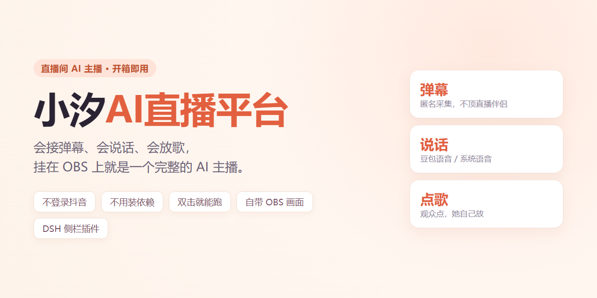

# 小汐 AI 直播平台 · 分销版 v2.6.87

> **AI 一键多功能全流程直播，支持国内多个平台。**
> 接弹幕、会说话、会放歌、进场欢迎、点歌台、自带 OBS 画面——开箱即播。
>
> 目前已接入**抖音**（匿名采集，不登录账号、不顶掉直播伴侣），其余平台陆续接入。



---

## 她能干什么

| 能力 | 说明 |
|---|---|
| **接弹幕** | 匿名采集直播间弹幕，**不登录账号、不顶掉直播伴侣** |
| **说话** | 豆包语音（火山引擎）或系统语音，可换音色、语速 |
| **回话** | 接大模型，按弹幕内容自然回应；一句话说完才说下一句 |
| **点歌** | 观众发歌名，她自己放；同一首歌自动去重 |
| **进场欢迎** | 有人进直播间自动打招呼，同一人 30 分钟内不重复 |
| **形象** | 自带立绘 + 6 种情绪（开心/生气/难过/哭/跺脚/待机） |
| **画面** | 自带 1920×1080 直播画面，OBS 浏览器源直接抓 |
| **DSH 插件** | 装进 DeepSeek Harness，左侧栏一键打开设置 |

## 三分钟跑起来

**1. 装 Node.js**（只需一次）：<https://nodejs.org> 选 LTS，一路下一步

**2. 下载并解压**：[整包下载](updates/xiaoxi-ai-live-2.6.87.zip)（3.7 MB）→ 解压到 `D:\xiaoxi-ai-live`

**3. 双击 `启动.cmd`**

浏览器会自动打开设置页 `http://127.0.0.1:8792/settings`，按顺序填：

```
抖音接入 → 直播间号 → 连接
说话方式 → 声音 → 填豆包密钥（不填就用系统语音）
直播画面 → 一键对齐 OBS
```

## 怎么停

| 方式 | 效果 |
|---|---|
| 关掉启动窗口 | 服务和后台一起停 |
| 双击 `停止.cmd` | 同上 |
| 设置页右上角「关闭服务」 | 同上 |

三种都会让后台完全退出，不会再说话。

## 想扔给 AI 装

把整包和这句话一起发给**能操作你电脑的 AI**（DSH / Claude Code 这类）：

```
按包里的 AGENT.md 把「小汐AI直播平台」装到 D:\xiaoxi-ai-live 并启动，装完把设置页地址发我。
```

## 自动更新

更新入口在 **DSH 左侧栏的「小汐AI直播平台」→ 右上角「检查更新」**，客户不用填任何地址。

更新**不会覆盖 `config.json`**（直播间号、语音密钥、人设都保留），旧版本备份在 `backup/<版本号>/`。

## 目录说明

```
app/        解压后的完整程序（可单独下某个文件）
updates/    manifest.json + 最近两个版本的整包
PUBLISHING.md   维护者发布说明
```

## 常见问题

**会顶掉直播伴侣吗？**
不会。全程匿名采集，不登录抖音账号。

**要装什么依赖吗？**
不要。零依赖，只要 Node.js。

**她自己开播吗？**
不开。推流还是用直播伴侣，她只负责弹幕、说话、画面。

**装在 C 盘行吗？**
能跑，但建议 D 盘，省空间。

---

> 维护者发布新版本、token 安全约定、镜像说明：见 [PUBLISHING.md](PUBLISHING.md)
